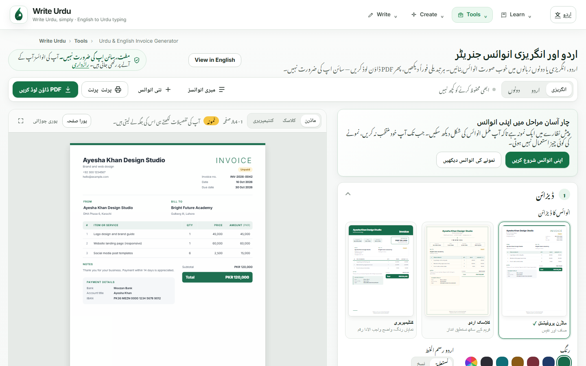
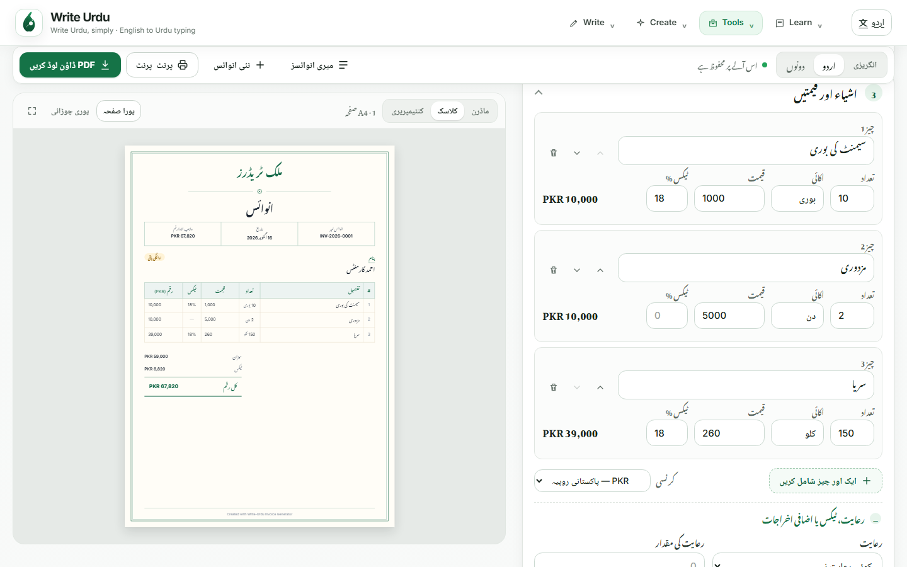
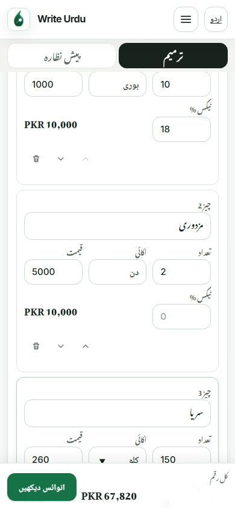
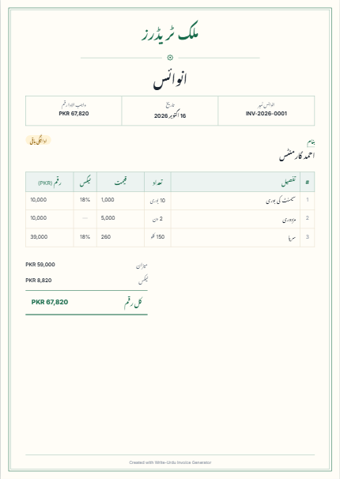
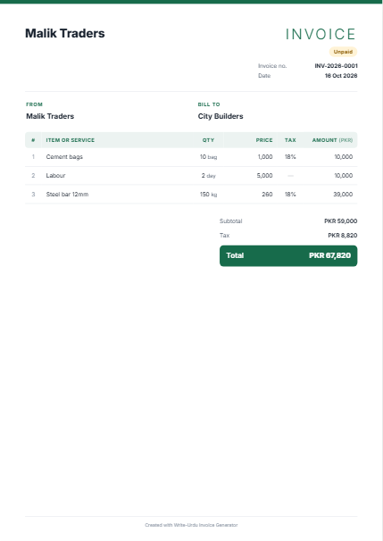
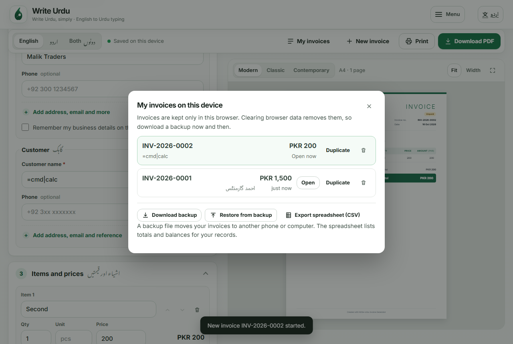

# Invoice Studio follow-ups — 2026-10-16

Spec: [`WU-IG-005`](../../../specs/WU-IG-005-invoice-studio-follow-ups.md). These screenshots come from local Playwright runs against the dev server.

## Urdu editor

The text in the items was typed in English letters and converted in the browser ("cement ki bori" became سیمنٹ کی بوری). The Tax % fields appear because tax is set to a rate for each item.

## Units and per-item tax on the invoice

 

## Backup, restore and spreadsheet

