# Invoice Generator UX audit and redesign — 2026-10-16

Spec: [`WU-IG-004`](../../../specs/WU-IG-004-invoice-studio-redesign.md). All screenshots in this folder come from local Playwright runs against the dev server. The `export-*` and `multipage-*` files are the real html2canvas output used for the PNG and PDF exports.

## Audit (before)

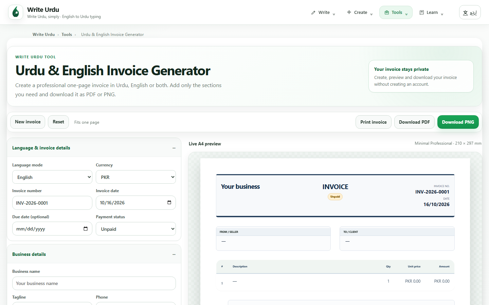 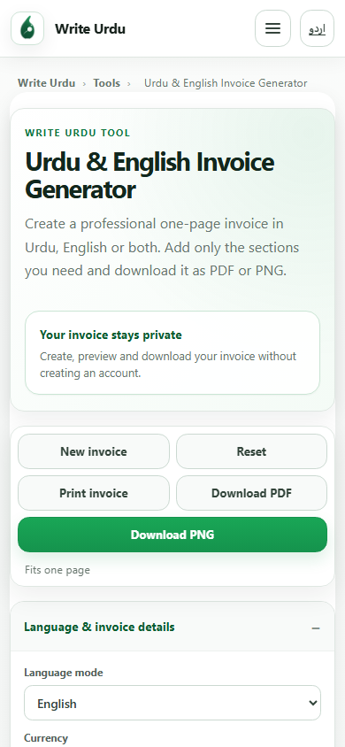

| Persona | What got in the way |
| --- | --- |
| A — Small-business owner (Urdu, 3 products) | Every field was visible at once, including two reference pairs, website and tagline. Urdu labels only showed on the invoice, not in the editor. The preview was a single Minimal Professional layout. |
| B — Freelancer (English, bank details, PDF) | Bank and IBAN fields sat in a collapsed panel at the bottom. The primary action was **Download PNG**, not PDF. There was no logo option. |
| C — Home tutor (simple bilingual) | Discount, tax and extra-charge fields looked mandatory. There was no explanation of how the totals were calculated. |
| D — Urdu-first Android user | The preview began about 3,440px down the page, after four screens of fields, and was too small to read. The sticky action bar covered content. There was no WhatsApp path. |
| E — Returning user | A draft needed a separate "Restore" click. **New** and **Reset** both deleted the draft without keeping a copy. Business details could not be reused, and there were no saved invoices. |
| All | "Load sample invoice" overwrote real fields, and the sample could be exported as if it were the user's invoice. Six items was the hard limit, and the copy said "one-page". Long content blocked export with "too much content". |

## Redesign (after)

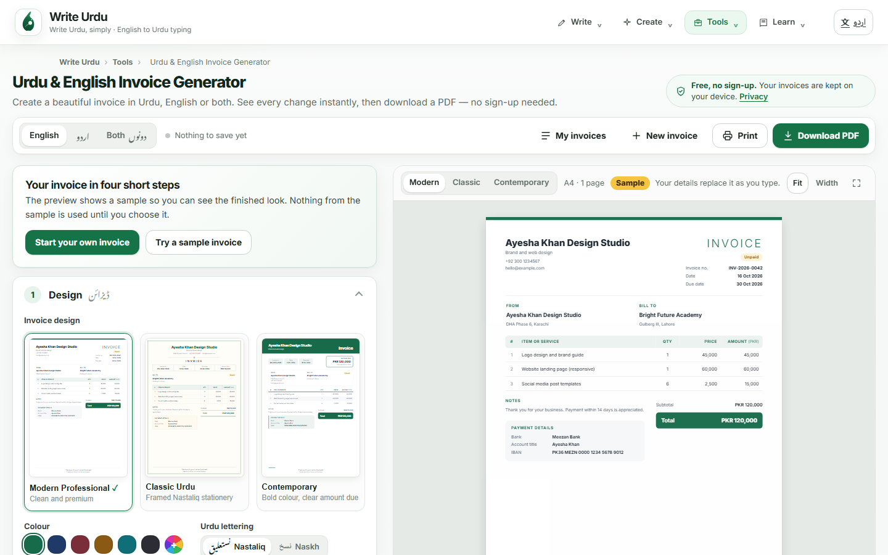
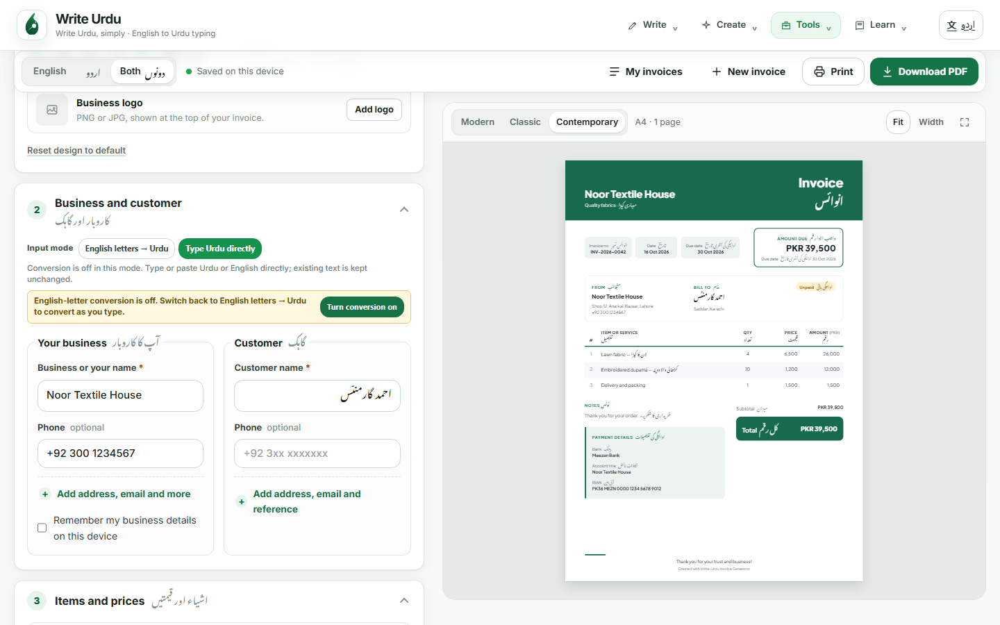

On mobile there are Edit and Preview modes and a sticky bottom action bar:

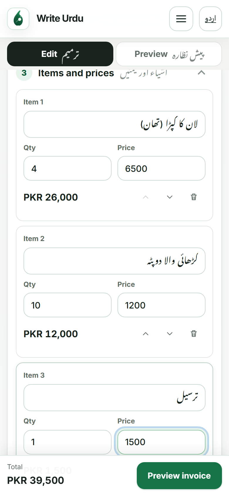 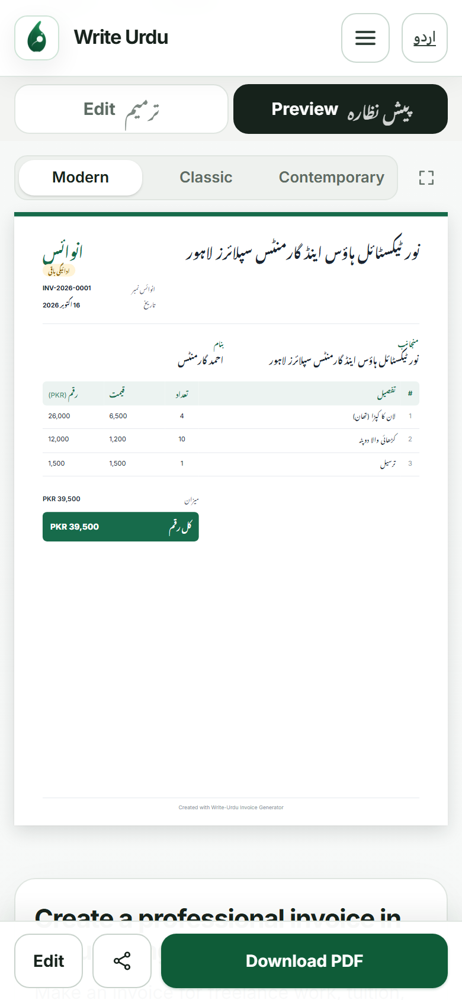 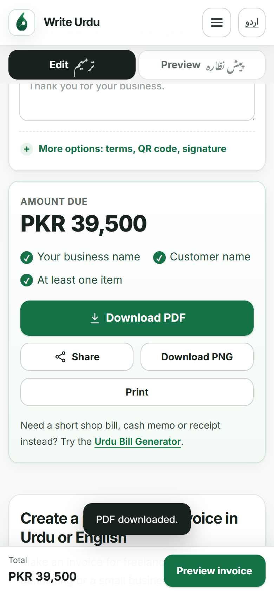

### Templates

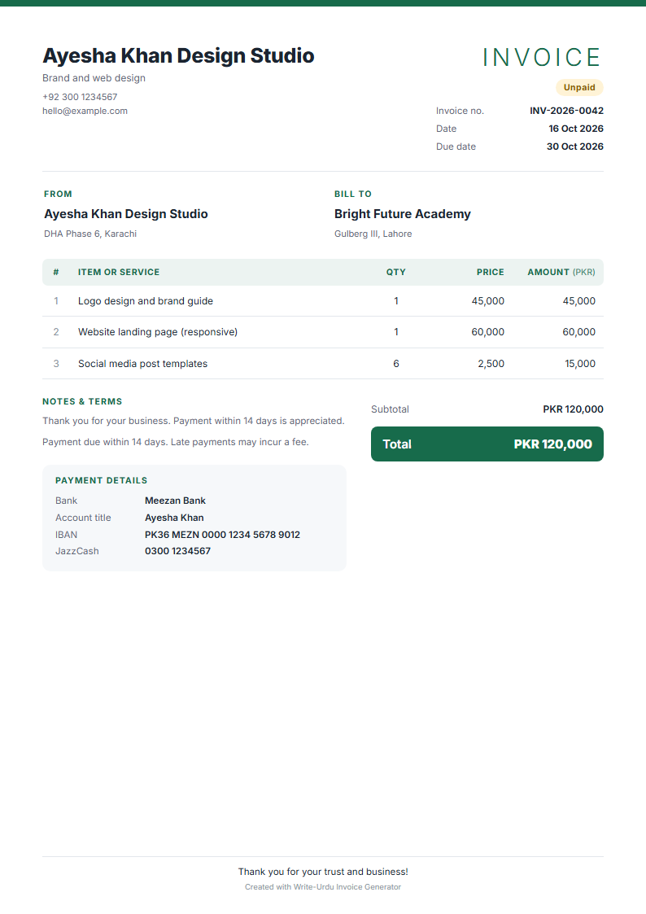 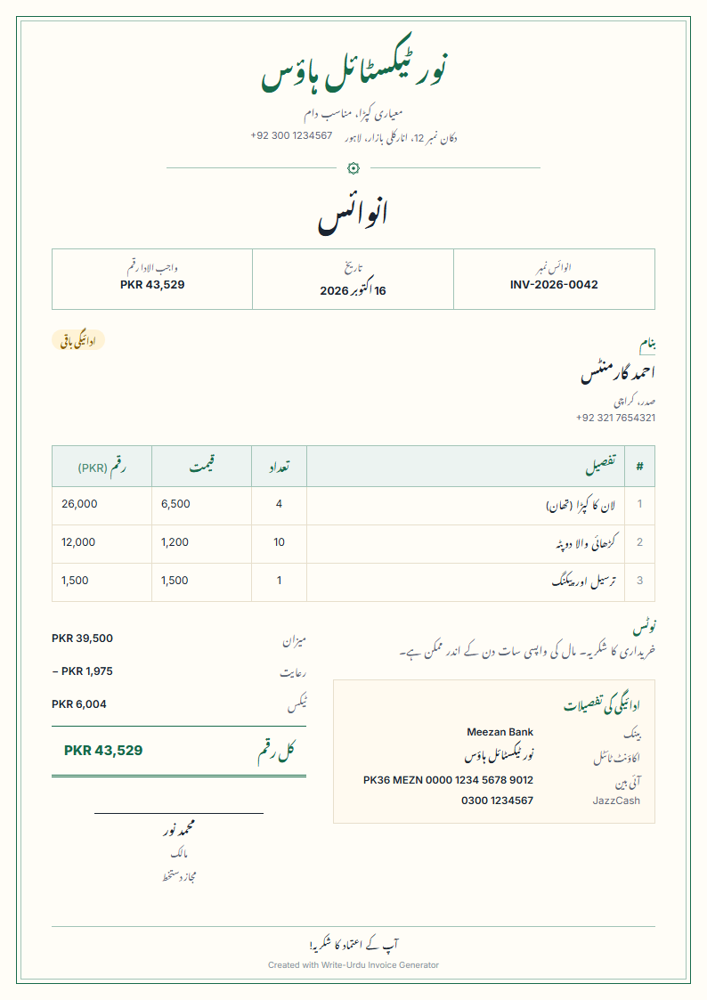 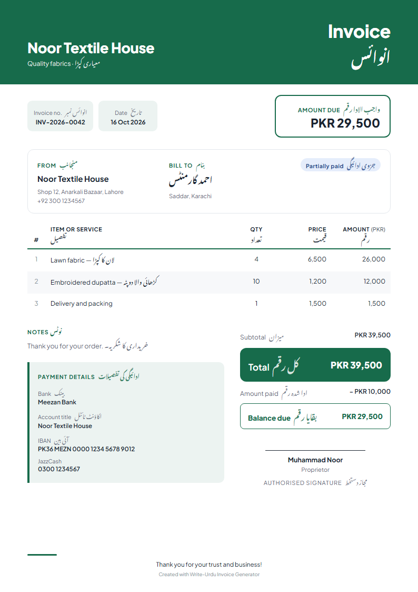

### Real exports

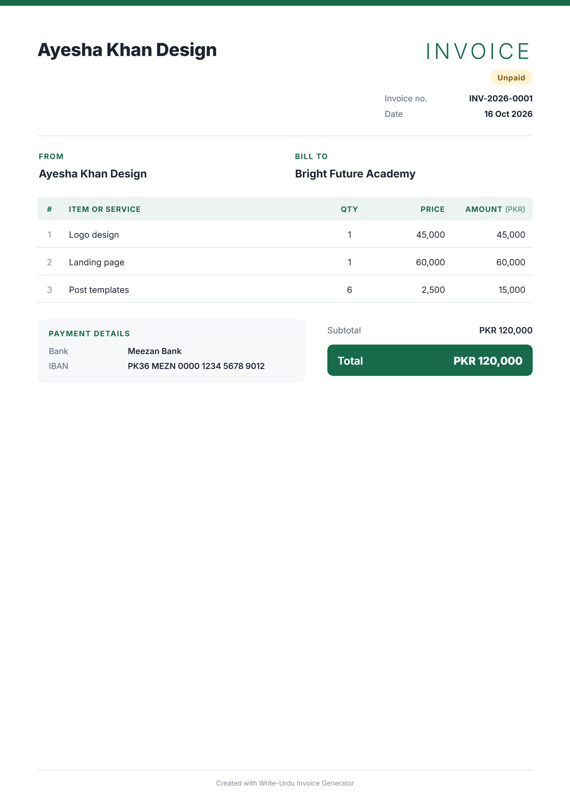 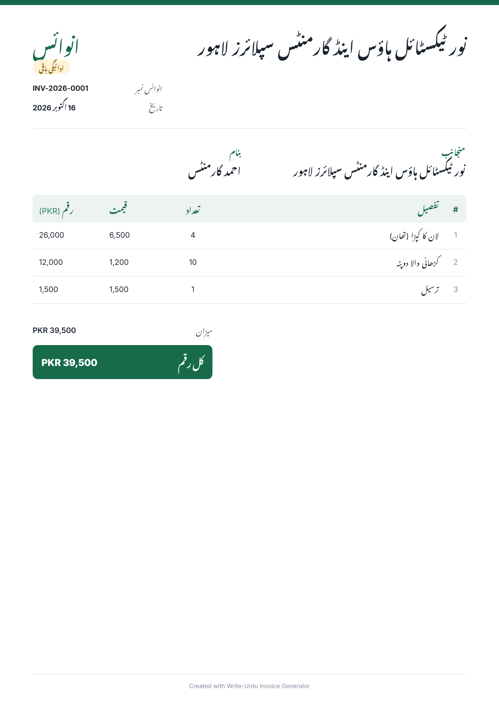

Pages 2 and 3 of a 28-item invoice. The heading repeats on each page, and the last two rows move to page 3 with the totals:

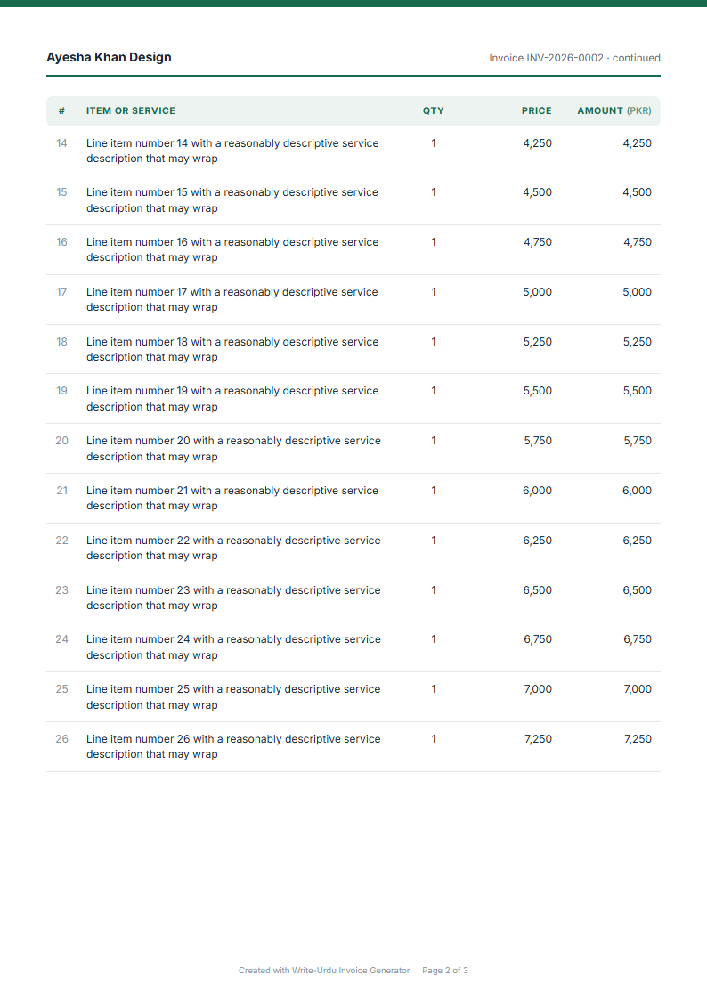 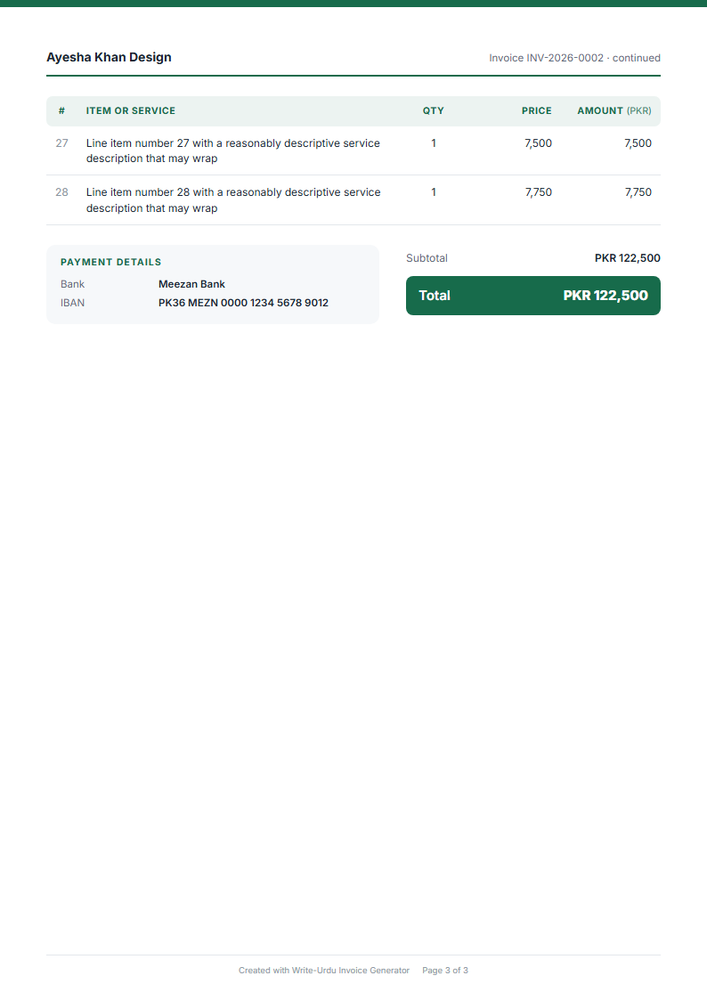
